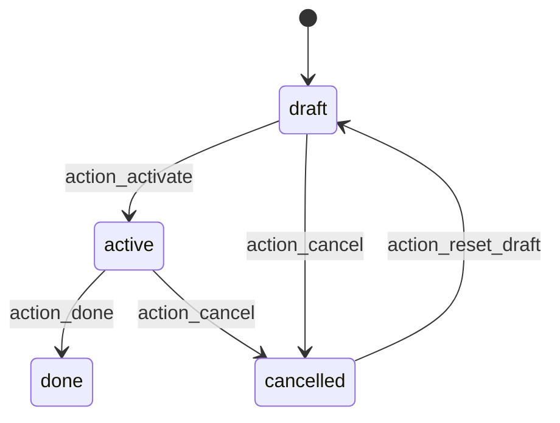

# eb_<module> — Business Logic

## 1. State machine: `eb_<module>.<entity>.state`

| Transition | Method (button) | Guard / validation | Allowed groups | Side effects |
|---|---|---|---|---|
| draft → active | `action_activate` | must have ≥1 line | user | assign sequence, post chatter msg |
| active → done | `action_done` | | user | |
| * → cancelled | `action_cancel` | not `done` | manager | |
| cancelled → draft | `action_reset_draft` | | manager | |

## 2. Computed / related fields
| Field | Depends on | Logic | Stored | Inverse / search |
|---|---|---|---|---|
| `total` | `line_ids.amount` | `sum(line_ids.amount)` | ✔ | — |
| `display_name` | `member_id`, `goal_id` | `"<member> - <goal>"` | ✗ | — |

## 3. Constraints (`@api.constrains`)
| Fields | Rule | Error message |
|---|---|---|
| `start_date`, `end_date` | `end_date >= start_date` | "End date must be after start date." |

## 4. Onchange behaviour (`@api.onchange`)
| Trigger field | Effect |
|---|---|
| `schedule_type` | clear fields not relevant to the selected type |

## 5. CRUD overrides
| Method | Behaviour |
|---|---|
| `create` (`@api.model_create_multi`) | assign `name` from `ir.sequence` `eb_<module>.<entity>` if `New` |
| `write` | _e.g. block edits when state = done_ |
| `unlink` (`@api.ondelete(at_uninstall=False)`) | _e.g. only draft/cancelled may be deleted_ |
| `copy` | _fields to reset: state → draft, name → New_ |

## 6. Wizards (TransientModel)
### `eb_<module>.<wizard>`
- **Opened from:** button / action on `<entity>` form
- **Fields:** 
- **Steps:** 
- **On confirm:** 

## 7. Other methods / public API
| Method | Signature | Called by | Description |
|---|---|---|---|
| | `def method(self, ...)` | UI / cron / XML-RPC | |
